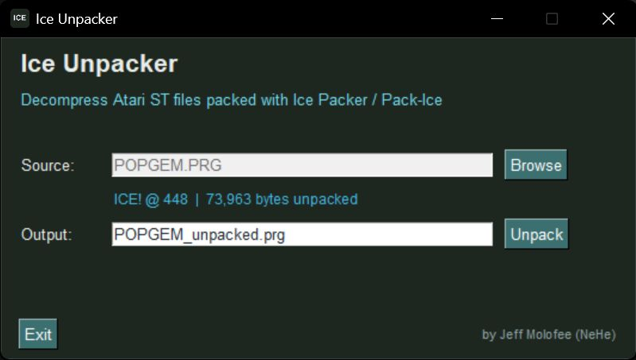

# Ice Unpacker for PC



Unpacks Atari ST executables packed with Pack-Ice (the "ICE!" / "Ice!" signature format). Produces the same result as unpacking with Ice on a real ST — a standard, runnable TOS executable.

## What's New

### v1.0.1
- **Fixed:** files whose signature is spelled `Ice!` (mixed case) were rejected with "Not an Ice Packer file". Both `ICE!` and `Ice!` are recognised now; the compressed format is identical. Found on a Pack-Ice 2.x executable whose payload header read `Ice!`.
- **Improved:** on the command line, a file that isn't Ice-packed (or can't be read) now prints a one-line error and exits with code 1 instead of a Python traceback.

### v1.0.0
- First release.

## Requirements

- Python 3.10+
- Optional: PySimpleGUI (`pip install PySimpleGUI`) — enables GUI mode

## Usage

**Windows:** Double-click `start_app.bat` — it creates a local `.venv` and installs dependencies from `requirements.txt`, then launches the app. If `.venv` isn't set up yet, `start_app.bat` automatically triggers `install.bat` first; you can also run `install.bat` directly ahead of time if you just want dependencies installed without launching the app. Command-line arguments are passed through, e.g. `start_app.bat packed.prg --identify`.

**GUI:** run with no arguments. Source is Browse-only (pick a packed file; typing a path directly isn't allowed). Output defaults to `<name>_unpacked.prg` in the same folder as the source, and is freely editable before you click Unpack.

**Manual (any platform):**

```
python ice_unpacker.py packed.prg
python ice_unpacker.py packed.prg -o output.prg
python ice_unpacker.py packed.prg --identify
```

## Building a standalone .exe

`build.bat` builds `dist\Ice Unpacker.exe` via PyInstaller (custom icon, no console window for GUI use) — no need to wait on the GitHub release workflow. The compiled exe stays windowed when double-clicked, but automatically attaches to your terminal's console and prints normally when run with CLI arguments from an existing shell.

## Examples

```
python ice_unpacker.py {filename}.prg
    -> writes {filename}_unpacked.prg

python ice_unpacker.py {filename}.prg --identify
    -> ICE signature found at offset : xxx
       Unpacked size : xxx,xxx bytes
```

## Supported Packers

- Pack-Ice ("ICE!" or "Ice!" signature)

**Not supported:** PFX/PFXPAK, Synergy, UPX, or other non-Ice packers.
**Not supported:** generic LHA archives (use lhasa for those).

## How It Works

1. Locates the "ICE!" (or "Ice!") signature in the file
2. Reads the unpacked size from the block header
3. Runs the reverse (end-to-start) LZ77-style decompressor, reconstructing literal runs and back-references from a bit-reversed, unary-prefix-coded bitstream
4. Writes the decompressed content — which is already a complete TOS file (header + text + data + relocation table) — directly to disk

## Notes

- Keep the original packed .prg to run on real hardware; some programs check their own filename or file size at startup.
